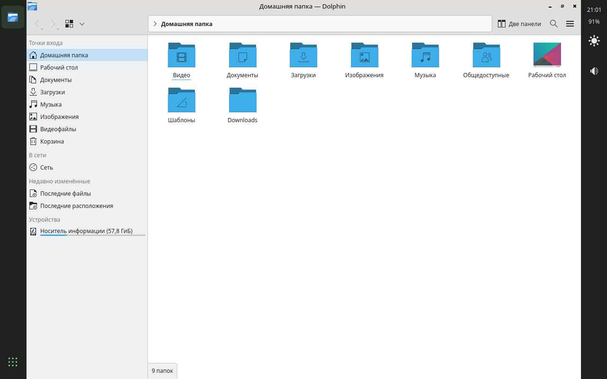
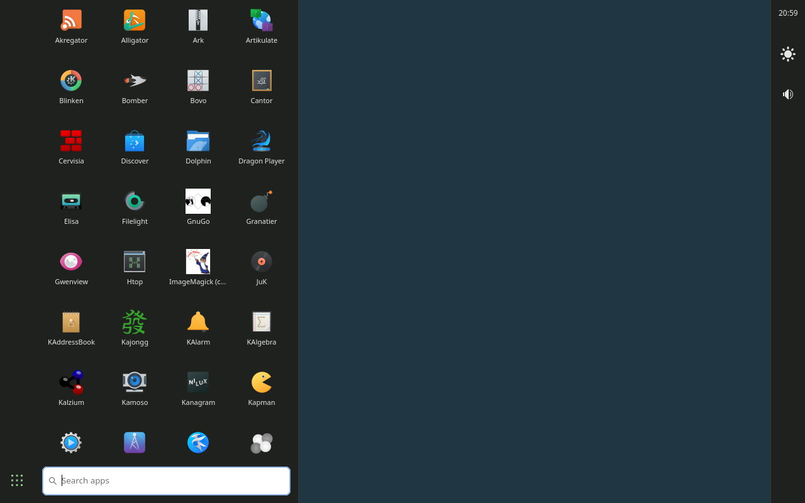

# Bayleaf

**A lightweight, touch-first Wayland shell for Linux tablets and 2-in-1s.**

Bayleaf aims to be what GNOME and KDE are on a touchscreen — edge swipes, an on-screen keyboard
that shows up when you need it, auto-rotation, a tablet mode that switches itself when you detach
the keyboard — but on hardware where those desktops are too heavy: 2 GB of RAM, an Atom CPU and
slow eMMC storage.

> **Status: pre-alpha.** The shell runs on the reference tablet on top of labwc; the compositor is
> not written yet. See [docs/roadmap.md](docs/roadmap.md).

## Screenshots

Reference tablet (1280×800), `bayleaf-shell` on labwc, early milestone M1.

| Side rails with an app | Launcher |
|---|---|
|  |  |

## Goals

- **Touch first, keyboard second.** Every action is reachable with a finger; docked mode adds
  keyboard and touchpad shortcuts on top, never instead.
- **Small.** Whole idle session (compositor + shell) under **300 MB RSS** on the reference device.
- **Tablet-aware.** Tablet / laptop mode follows the keyboard dock; rotation follows the
  accelerometer, with touch input mapped correctly in every orientation.
- **Built for hands.** Side rails keep apps under the left thumb and device controls under the
  right one; each window carries its own back, menu and close. Height stays with the app. Docked, the rails turn into a familiar taskbar.
  See [docs/design/rails.md](docs/design/rails.md).
- **Boring tech.** Rust, [Smithay](https://github.com/Smithay/smithay), GTK4 for the shell UI, standard Wayland protocols
  (layer-shell, foreign-toplevel, input-method-v2, virtual-keyboard) so existing apps just work.

## Non-goals

- Phone form factor (see Phosh, Sxmo, Plasma Mobile).
- A full desktop environment: Bayleaf ships a shell, not an app suite. Use your favourite apps.

## Reference hardware

HP Pavilion x2 10 (Intel Atom Z3736F "Bay Trail", 2 GB RAM, 64 GB eMMC, 1280×800 touchscreen,
32-bit UEFI, USB keyboard dock). Anything with a touchscreen and a Wayland-capable GPU should work.

## Architecture (planned)

| Component | Crate | What it does |
|---|---|---|
| Compositor | `bayleaf-comp` | Smithay-based compositor: windows, touch gestures, tablet mode, rotation |
| Shell | `bayleaf-shell` | Side rails, launcher, quick settings, notifications (layer-shell clients) |
| Keyboard | `bayleaf-osk` | On-screen keyboard (input-method-v2 + virtual-keyboard) |
| IPC | `bayleaf-ipc` | Shared types and protocol between compositor and shell |

Details: [docs/architecture.md](docs/architecture.md).

## Building

Not yet. Development happens on Linux (or WSL2 with WSLg); see [CONTRIBUTING.md](CONTRIBUTING.md).

## License

GPL-3.0-or-later. See [LICENSE](LICENSE).
